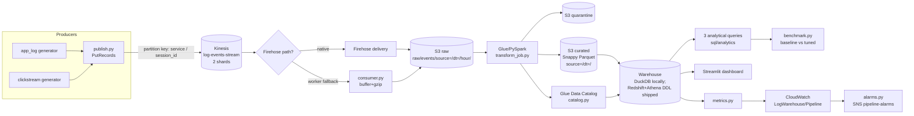
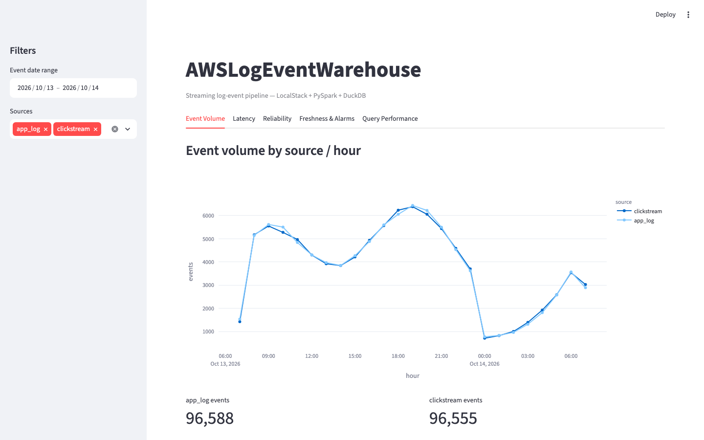
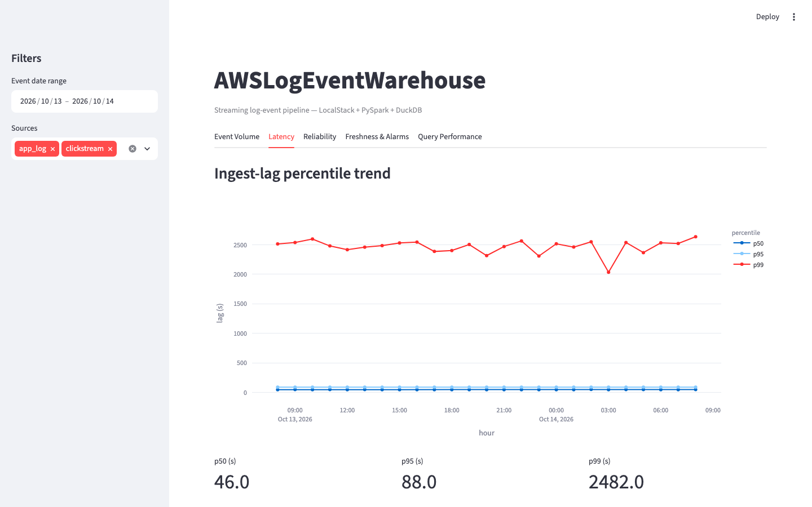
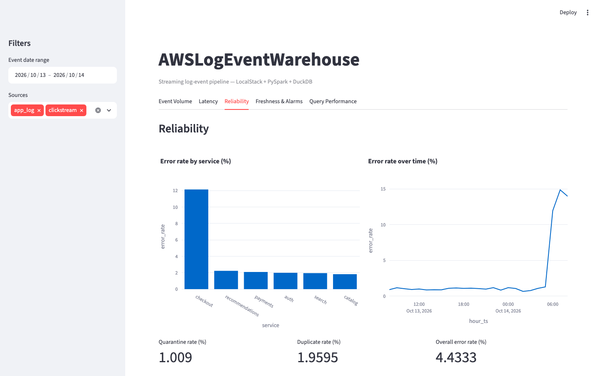
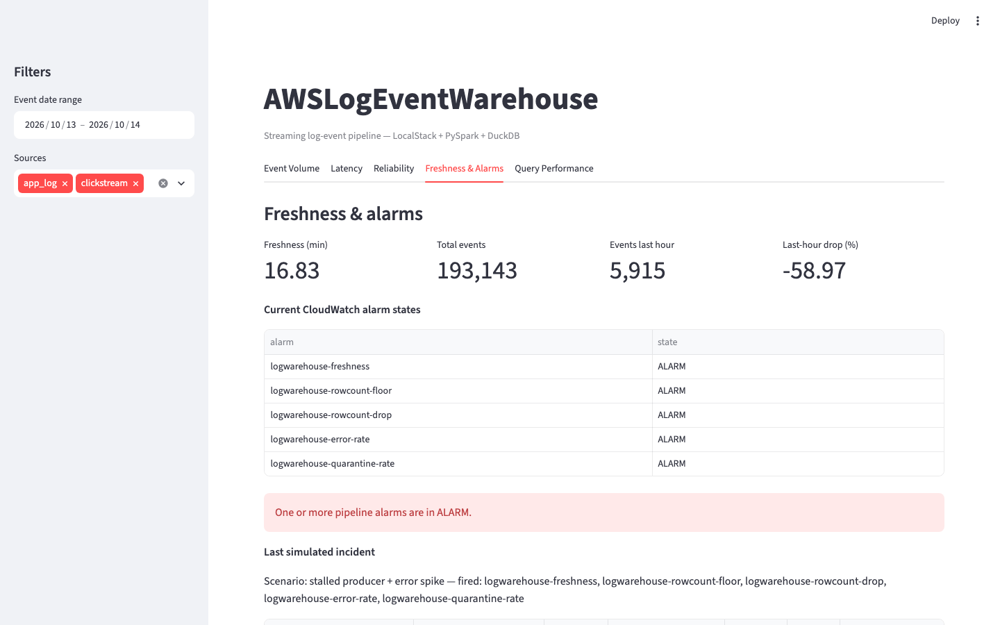
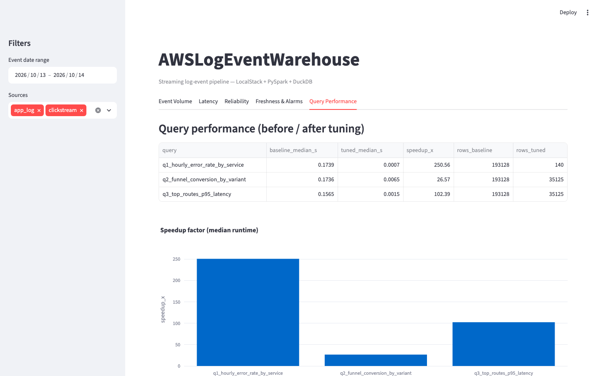

# AWSLogEventWarehouse

An AWS-native streaming log-event data platform that runs end to end on a
laptop with **no AWS account and no cloud spend**. Two producers (application
logs and clickstream events) publish JSON into **Kinesis Data Streams**; a
Firehose-style delivery layer lands them in an **S3 raw zone** partitioned by
date/hour; a **PySpark "Glue" job** parses, de-duplicates, quarantines and
transforms the raw JSON into partitioned Snappy Parquet; a **dimensional model**
is loaded into a warehouse and queried with SQL; three expensive queries are
benchmarked before/after tuning; and a **Streamlit + Plotly dashboard** plus
**CloudWatch alarms** surface volume, latency, reliability and freshness.

Everything is driven by genuine AWS APIs through boto3 and defined in
Terraform. Local AWS is provided by **LocalStack** (S3, CloudWatch, SNS, IAM,
Logs) plus a **moto** sidecar for the three services LocalStack community does
not implement well (Kinesis, Glue, Firehose) — see
[Local stand-ins](#local-stand-ins). The same code points at real AWS by
changing environment variables only.

---

## 1. Architecture



### Service → code → local stand-in

| AWS service | Where it is used | Local stand-in |
| --- | --- | --- |
| S3 | `src/producers/consumer.py`, `src/glue/run.py`, `src/warehouse/load.py` | LocalStack (`:4566`) |
| Kinesis Data Streams | `src/producers/publish.py`, `src/producers/consumer.py` | moto sidecar (`:4567`) |
| Firehose | `src/producers/consumer.py` (native probe + worker) | moto control plane; worker does the delivery |
| Glue (Spark) | `src/glue/transform_job.py` | local `SparkSession` (Glue-compatible code) |
| Glue Data Catalog | `src/glue/catalog.py` | moto sidecar |
| CloudWatch (metrics + alarms) | `src/monitoring/metrics.py`, `src/monitoring/alarms.py` | LocalStack |
| SNS | `src/monitoring/alarms.py` | LocalStack |
| IAM / CloudWatch Logs | `infra/terraform/main.tf` | LocalStack |
| Infrastructure as code | `infra/terraform/*` | Terraform (provider override → LocalStack/moto) |

### Local stand-ins

LocalStack community edition does not implement the Glue and Firehose control
planes (they are Pro features) and its `kinesis-mock` backend degrades
super-linearly: publishing 200k records fell from ~9,000 to ~300 rec/s.
A [moto](https://github.com/getmoto/moto) server (docker-compose service
`moto`) therefore serves **Kinesis, Glue and Firehose** with the identical AWS
APIs; every other service runs on LocalStack. On real AWS, unset
`KINESIS_ENDPOINT_URL`, `GLUE_ENDPOINT_URL` and `FIREHOSE_ENDPOINT_URL` and the
clients fall back to `AWS_ENDPOINT_URL` / standard endpoints. boto3/botocore are
pinned to `1.34.162` because newer botocore breaks the CloudWatch query protocol
against the local mocks.

### Dimensional model (ERD)

Full ERD, grain, surrogate-key strategy and SCD notes live in
[`docs/data_model.md`](docs/data_model.md). Short version:

- `fact_event_activity` — grain: one curated event (app_log **or** clickstream).
- `fact_session_rollup` — derived, one row per clickstream session.
- `dim_date`, `dim_service`, `dim_page`, `dim_user`, `dim_device_geo`.
- Surrogate keys are deterministic `hash(natural_key) % 2^63-1`, so they are
  stable across reloads and identical across the DuckDB/Redshift/Athena DDL.
- `dim_user` is SCD Type 1 today; the Type 2 extension
  (`valid_from`/`valid_to`/`is_current` + versioned key) is documented.

### Sort/dist key rationale (Redshift DDL — `sql/ddl_redshift.sql`)

| Choice | Why |
| --- | --- |
| `fact_event_activity DISTKEY(user_sk)` | funnel/session joins to `dim_user` stay node-local |
| `fact_event_activity SORTKEY(dt, service_sk, event_ts)` | every query filters `dt` (zone-map pruning) and q1 groups by service |
| all dimensions `DISTSTYLE ALL` | they are small and joined by every fact query → no broadcast |
| `ENCODE delta/zstd/bytedict` | delta on monotonic keys, zstd on high-cardinality text, bytedict on low-cardinality categories |
| Parquet partitioned by `dt` | q1/q2/q3 all carry a `dt >= current_date - 30 DAY` predicate → partition pruning |

---

## 2. How to run

### Prerequisites

- Docker (Desktop or equivalent)
- Python 3.11
- Terraform ≥ 1.5 (the Makefile also looks in `~/.local/bin`)
- A JDK (Java 17 or 21) for Spark

### Steps

```bash
make install     # create .venv and install the package + dev extras
make up          # start LocalStack + moto (docker compose) and wait for health
make tf-init     # terraform init (uses infra/terraform)
make tf-apply    # provision S3 buckets, Kinesis stream, Firehose, Glue DB, SNS, log group
make pipeline    # full end-to-end run (resets local state, then all 9 stages)
make bench       # (re)run the baseline-vs-tuned SQL benchmark
make dashboard   # serve the Streamlit dashboard at http://localhost:8501
make test        # ruff + pytest with coverage
```

`scripts/bootstrap.sh` performs `make up` + `tf-apply` + local pro-resource
provisioning in one command.

### Pointing at real AWS

Copy `.env.example` to `.env` and set:

```bash
AWS_ENDPOINT_URL=            # empty -> standard AWS endpoints
KINESIS_ENDPOINT_URL=        # empty -> AWS_ENDPOINT_URL / real AWS
GLUE_ENDPOINT_URL=
FIREHOSE_ENDPOINT_URL=
AWS_REGION=us-east-1
AWS_ACCESS_KEY_ID=...        # or use your normal credential chain
AWS_SECRET_ACCESS_KEY=...
RAW_BUCKET=... CURATED_BUCKET=... STREAM_NAME=...
```

Then remove `infra/terraform/localstack_override.tf` (or set
`use_localstack = false`) and `terraform apply` against your account.

### Tear down

```bash
make tf-destroy  # destroy the provisioned resources
make down        # stop LocalStack + moto
```

---

## 3. Results

All numbers below come from one real `make pipeline` run whose artifacts are
checked in under `artifacts/`.

### Ingest

| Metric | Value | Source |
| --- | --- | --- |
| Total events ingested | **200,000** (100k app_log + 100k clickstream) | `artifacts/ingest_report.json` |
| Kinesis publish throughput | ~890 rec/s (produce stage 224.6 s) | `artifacts/pipeline_run.json` |
| Delivery throughput | **21,112.8 rec/s** | `artifacts/ingest_report.json` |
| S3 raw partitions | **50** | `artifacts/ingest_report.json` |
| S3 raw objects (gzip) | **68** | `artifacts/ingest_report.json` |
| Raw uncompressed bytes | 76,216,226 | `artifacts/transform_report.json` |
| Delivery path | `worker` (Firehose accepted but did not deliver locally) | `artifacts/ingest_report.json` |

### Transform (PySpark / Glue job)

| Metric | Value |
| --- | --- |
| Rows in | 200,000 |
| Rows out (curated) | **193,128** |
| Duplicates removed | **3,919** (≈2.0%) |
| Rows quarantined (unparseable) | **2,018** (≈1.0%) |
| Null-key rows dropped | **935** (≈0.5%) |
| Curated Parquet size | 20,348,325 bytes (8 files) |
| Raw gzip size | 13,784,878 bytes |
| **Compression ratio (uncompressed raw → curated Parquet)** | **3.75×** |
| Curated files (small-file control) | 8 |

Ingest-lag percentiles: **p50 46 s / p95 88 s / p99 2,482 s** — the p99 is the
injected ~3% late-arriving events (`artifacts/metrics_snapshot.json`).

### Warehouse

| Table | Rows |
| --- | --- |
| `fact_event_activity` | **193,128** |
| `dim_user` | 48,938 |
| `fact_session_rollup` | 96,541 |
| `dim_service` | 6 |

All integrity checks pass: `fact_rows == curated_rows`, zero orphan
`service/page/user/device_geo` keys, zero duplicate surrogate keys
(`artifacts/warehouse_report.json`).

### Query tuning benchmark (baseline → tuned)

5 measured runs per query (one warm-up discarded), median + p95 wall-clock.

| Query | Baseline median | Tuned median | Speedup | Baseline p95 | Tuned p95 | Rows scanned | Bytes scanned | Results match | Technique credited |
| --- | --- | --- | --- | --- | --- | --- | --- | --- | --- |
| q1 hourly error rate by service | 0.173888 s | 0.000694 s | **250.6×** | 0.198214 s | 0.000803 s | 193,128 → 140 | 32,267,011 → 2,671 | ✅ | pre-aggregated hourly rollup Parquet |
| q2 funnel conversion by variant | 0.173625 s | 0.006535 s | **26.6×** | 0.180103 s | 0.006989 s | 193,128 → 35,125 | 32,267,011 → 1,968,529 | ✅ | partitioned Snappy Parquet + `dt` pruning + column projection |
| q3 top routes p95 latency | 0.156456 s | 0.001528 s | **102.4×** | 0.168384 s | 0.002086 s | 193,128 → 35,125 | 32,267,011 → 1,968,529 | ✅ | `dt` pruning + physical sort on `(service, event_ts)` + narrow projection |

Baseline = one uncompressed CSV, no pruning, `SELECT *`-style joins, no sort.
Tuned = partitioned Snappy Parquet, `dt` push-down, sorted, narrow projections,
and a pre-aggregated rollup where justified. `results_match = true` for all
three (correctness-preserving tuning). Full table:
[`artifacts/query_benchmark.md`](artifacts/query_benchmark.md).

### Monitoring

Healthy snapshot: freshness **3.7 min**, overall error rate **4.43%**,
quarantine rate **1.01%**, duplicate rate **1.96%**, last complete hour
**9,085 events**. The `alarms --check` data-quality gate **passes** on healthy
data (exit 0).

Simulated incident (**stalled producer + error spike**): **all 5 alarms fire**
(genuine CloudWatch `ALARM` state transitions):

| Alarm | Observed | Threshold | State |
| --- | --- | --- | --- |
| `logwarehouse-freshness` | 360 min | > 120 | ALARM |
| `logwarehouse-rowcount-floor` | 0 events | < 100 | ALARM |
| `logwarehouse-rowcount-drop` | 100 % | > 60 | ALARM |
| `logwarehouse-error-rate` | 15 % | > 5 | ALARM |
| `logwarehouse-quarantine-rate` | 6 % | > 2 | ALARM |

Evidence: [`artifacts/alarm_evidence.json`](artifacts/alarm_evidence.json).

### Pipeline wall-clock

| Stage | Seconds |
| --- | --- |
| bootstrap (reset + provision) | 2.6 |
| produce (200k → Kinesis) | 224.6 |
| deliver (Kinesis → S3 raw) | 9.9 |
| transform (PySpark) | 21.4 |
| catalog | 0.1 |
| load (DuckDB) | 1.0 |
| benchmark | 5.0 |
| monitor | 0.2 |
| incident replay | 2.3 |
| **Total** | **267.0 s (≈4 m 27 s)** |

### Tests

- **51 tests** (48 unit + 3 integration), all green.
- **Coverage: 53%** (`artifacts/coverage.xml`, modules: `logwarehouse`,
  `producers`, `glue`, `warehouse`, `monitoring`).

---

## 4. Dashboard

Streamlit + Plotly, five tabs: **Event Volume**, **Latency**, **Reliability**,
**Freshness & Alarms**, **Query Performance**. Filters (date range, source) run
as SQL against DuckDB.







### QuickSight wiring

The dashboard is a QuickSight stand-in. QuickSight-ready assets are checked in:

- `dashboard/quicksight/manifest.json` — data source + dataset bundle pointing
  at the Athena tables.
- `dashboard/quicksight/dataset_definition.json` — dataset with `curated_app_log`
  and `curated_clickstream` physical tables, `DIRECT_QUERY` mode, and calculated
  fields (`error_rate`, `p95_latency_ms`, `freshness_minutes`).

Wiring the same curated tables to QuickSight: create the Athena external tables
from `sql/ddl_athena.sql` (partition projection, no crawler needed), register
the datasets from `dataset_definition.json`, then recreate the five tabs as
QuickSight sheets.

---

## 5. Troubleshooting

See [`docs/runbook.md`](docs/runbook.md) for symptom → diagnose → fix playbooks:
stuck shard iterator, Firehose not delivering, small-file explosion, schema
drift in raw JSON, partition not registered in the Glue Catalog, and alarm
false positives.

---

## 6. Limitations & what would change on real AWS

- **Kinesis/Glue/Firehose run on moto locally.** LocalStack community cannot do
  the Glue/Firehose control planes and its Kinesis mock is too slow. On real AWS
  the endpoints resolve to the real services with no code change.
- **The Glue job runs as local PySpark.** `build_glue_context()` isolates the
  `awsglue` imports behind a shim, so the same script runs as a Glue 4.0 job.
  Real Glue adds job **bookmarks** (incremental processing), Glue workers/DPUs,
  and a crawler in place of the crawler-equivalent partition registration in
  `glue/catalog.py`.
- **Warehouse engine.** DuckDB mimics Redshift/Athena semantics (external
  Parquet scans, partition pruning, column compression, sort/cluster ordering).
  The real Redshift DDL (`DISTKEY`/`SORTKEY`/`ENCODE`) and Athena DDL are
  shipped. On real Redshift you would additionally tune **WLM queues**,
  `VACUUM`/`ANALYZE` and materialized views; on Athena you would tune file
  sizes, partition projection and workgroup limits.
- **Firehose dynamic partitioning.** Locally the worker writes partitioned
  objects itself. On real AWS you would enable Firehose dynamic partitioning
  (`!{partitionKeyFromQuery:source}`) instead of the static `source=app_log`
  prefix.
- **Corpus size.** The local Kinesis mocks degrade with stream size, so the
  checked-in run uses 200k events (~4 m). 1M events would take ~25 minutes
  locally; raise `APP_LOG_EVENTS`/`CLICKSTREAM_EVENTS` to scale up.
- **Cost notes.** On real AWS the dominant costs would be Kinesis shard-hours +
  PUT payload units, Firehose data volume, S3 storage/requests, Glue DPU-hours,
  Redshift cluster-hours (or Athena bytes-scanned), and CloudWatch metrics/alarms.

---

## Repository layout

```
src/logwarehouse/   settings + boto3 helpers
src/producers/      generators, Kinesis publisher, S3 delivery worker
src/glue/           Glue-compatible PySpark transform + Glue Catalog
src/warehouse/      DuckDB dimensional load + benchmark
src/monitoring/     CloudWatch metrics, alarms, incident simulator
src/dashboard/      Streamlit + Plotly dashboard
sql/                DuckDB / Redshift / Athena DDL + analytics queries
infra/terraform/    all infrastructure as code
scripts/            bootstrap, reset, run_pipeline, screenshots
docs/               data model, runbook, dashboard screenshots
artifacts/          real run reports (JSON/Markdown) + warehouse.duckdb
```

## License

MIT — see [LICENSE](LICENSE).
