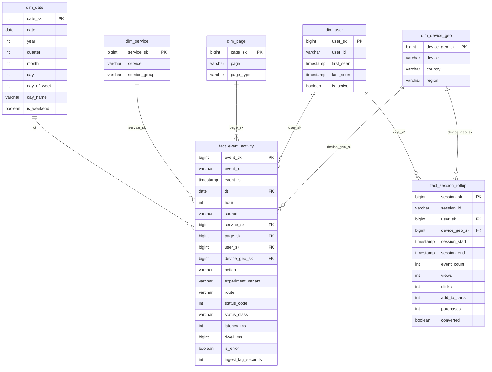

# Dimensional model

The warehouse is a small star schema built from the curated Parquet. It is
implemented in DuckDB locally (`sql/ddl_duckdb.sql`); the equivalent Redshift
DDL (`sql/ddl_redshift.sql`) and Athena external tables
(`sql/ddl_athena.sql`) are checked in for real AWS.

## ERD



## Grain

- `fact_event_activity` — **one row per curated event** (application log or
  clickstream). This is the transactional fact every analytical query starts
  from; `source` discriminates the two producers and the source-specific
  columns are null for the other source.
- `fact_session_rollup` — **one row per clickstream session**, a derived
  accumulating-snapshot fact used for funnel/conversion analysis without
  re-scanning the full event fact.

## Surrogate-key strategy

Every dimension uses a **deterministic 64-bit surrogate key**:

```sql
CAST(hash(<natural key>) % 9223372036854775807 AS BIGINT)
```

- Deterministic hashing means keys are identical across reloads and between the
  DuckDB, Redshift and Athena implementations — no sequence table and no
  key-lookup join during load.
- Cross-source conformed dimensions (`dim_user`, `dim_device_geo`) use the same
  hash for the same natural key regardless of which producer emitted the event.
- The facts carry the surrogate foreign key, so a caller never has to know the
  natural key format.

Uniqueness and referential integrity are asserted on every load
(`warehouse.load.validate`): zero duplicate `event_sk`, zero orphan
`service_sk`/`page_sk`/`user_sk`/`device_geo_sk`.

## Slowly changing dimensions

`dim_user` is implemented as **SCD Type 1** (latest attributes win): it stores
`first_seen`/`last_seen` (min/max event time) and `is_active`. This is enough
because user *attributes* here are effectively immutable identifiers.

The documented Type 2 extension (not needed for the current attributes but
described so the model is honest about its limits) adds:

| column | purpose |
| --- | --- |
| `user_version_sk` | new surrogate per version (hash of `user_id`, `valid_from`) |
| `valid_from` / `valid_to` | version validity window |
| `is_current` | flag for the open version |

Facts would then reference `user_version_sk` so historical rows keep the
attribute values that were true at event time. The change is additive: the
conformed `dim_user.user_sk` stays as the natural-key hash.

## Normalisation vs. dimensional rationale

The curated layer is deliberately **flat and normalised-ish** (one wide row per
event) because it is optimised for cheap append and columnar scans. The
warehouse layer is **dimensional** because it is optimised for read queries:

- Analysts filter/group by a handful of conformed dimensions (service, page,
  user, device/geo, date); a star schema keeps those joins small and
  predictable.
- Dimensions are **denormalised** (`dim_service.service_group`,
  `dim_page.page_type`, `dim_device_geo.region`) to avoid extra joins for
  common roll-ups.
- The source-specific columns live on the fact rather than in satellite tables
  to keep the two producers query-compatible without unions at query time.

## Key choices tied to query patterns

| Table | Key | Query pattern it serves |
| --- | --- | --- |
| `fact_event_activity` | Redshift `DISTKEY(user_sk)` | funnel/session joins to `dim_user` stay node-local |
| `fact_event_activity` | Redshift `SORTKEY(dt, service_sk, event_ts)` | q1/q3 30-day `dt` filters prune sorted blocks; q1 groups by service |
| all dimensions | Redshift `DISTSTYLE ALL` | every fact query joins them, so replicate to avoid broadcast |
| Parquet | partition by `dt` | q1/q2/q3 all carry a `dt >= current_date - 30` predicate |
